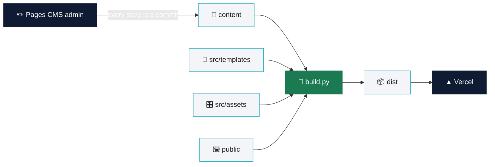

<div align="center">

# 🎨 Moinul Islam Rehan, portfolio

**A small static portfolio site, built by one Python file and edited from a friendly admin.**
Content lives in JSON, `build.py` turns it into web pages in `dist/`, and Vercel publishes them.


[How it works](#-how-it-works) · [Preview](#-preview-on-this-mac) · [Edit content](#-edit-content) · [Pages](#-pages) · [Projects](#-projects) · [Folders](#-folders) · [Deploy](#-deploy-on-vercel)

</div>

---

## 🧭 How it works

A small static site. `build.py` turns the content files into web pages in `dist/`. It needs only Python 3, which macOS and Vercel already have, so there is nothing to install.

Click any box to open that part of the repo.



> [!NOTE]
> `dist/` is made by `build.py` and is not stored in git. Vercel builds it fresh on every deploy.

---

## 👀 Preview on this Mac

```sh
python3 build.py --serve
```

Then open http://127.0.0.1:5500/. Run it again after changing anything.

<details>
<summary><b>More build options</b></summary>

<br>

| Command | What it does |
|---|---|
| `python3 build.py` | Build once into `dist/` |
| `python3 build.py --serve` | Build, then preview at http://127.0.0.1:5500/ |
| `python3 build.py --serve --port 5600` | Same, on another port |

</details>

---

## ✏️ Edit content

Use the admin, Pages CMS, at https://app.pagescms.org (or `/admin` on the live site). Sign in with GitHub and open this repository. Every save is a commit, and Vercel rebuilds the site by itself.

| In the admin | File | Page |
|---|---|---|
| Projects | `content/projects/<name>.json` | `/projects/<name>/` (featured ones also on the home page) |
| Blog posts | `content/posts/<name>.json` | `/blog/<name>/` (only when "Publish on the site" is on) |
| About page | `content/about.json` | `/about/` |

Images live in `public/images/`. Use JPG or WebP, about 1600 px wide and under 500 KB.

> [!TIP]
> A project's file name is its web address: `content/projects/handynaija.json` becomes `/projects/handynaija/`. The home page shows up to three featured projects, lowest order number first.

<details>
<summary><b>🧱 Case study blocks</b> · what a project's story can be built from</summary>

<br>

The admin forms are defined in [`.pages.yml`](./.pages.yml). A project's Story is a list of blocks in any order:

| Block | What it holds |
|---|---|
| Text | Heading and paragraphs |
| Image | One image with alt text and caption |
| Image grid | Several images with alt text, and a caption |
| Before and after | Two images side by side, each with alt text |
| Quote | Quote, name, role and company |
| Numbers | Value and label pairs, for example "3 weeks" or "12 screens" |

A project can also carry a headline, category, summary, cover (with crop focus), role or credit, client, year, status (Shipped or In progress), platform, tools, links and one key decision.

</details>

---

## 🗂 Pages

The pages `build.py` writes:

| Address | What is on it |
|---|---|
| `/` | Home: the canvas cover, up to three featured projects, notes, record, comments and contact |
| `/projects/` | Every published project |
| `/projects/<name>/` | One page per project |
| `/about/` | From `content/about.json` |
| `/contact/` | Email, booking link, profiles and the brief builder |
| `/blog/` | Every published post, newest first |
| `/blog/<name>/` | One page per post |
| `/404.html` | Shown for an address that does not exist |

> [!NOTE]
> The Blog link only appears in the menu once there is a published post to read.

<details>
<summary><b>🖱 The canvas cover</b> · a small Figma-like canvas on the home page</summary>

<br>

Without JavaScript the cover is the finished frame. With JavaScript its layers (the headline selection, the portrait frame and the three notes) can be moved, resized, panned and inspected.

| Tool | Key |
|---|---|
| Move | `V` |
| Hand | `H` |
| Inspect | `I` |
| Tidy up, Reset | Toolbar buttons |

Arrow keys move a layer by 8 pixels, Shift with an arrow key resizes it where it can be resized, and Escape clears the selection. Motion plays once, only while it is on screen, and never when the visitor asks to reduce motion.

</details>

---

## 💼 Projects

| Project | Headline | What it is | Year | On home | Case study |
|---|---|---|---|---|---|
| [HandyNaija](./content/projects/handynaija.json) | Find a trusted pro, in minutes | Trusted home-service marketplace | 2025 | ✅ | [Behance](https://www.behance.net/gallery/243840891/HandyNaija-Design-a-Trusted-Home-Service-Marketplace) |
| [SUEDE](./content/projects/suede.json) | Reviews that actually fit | Fashion review platform · UX audit and redesign | | ✅ | [Behance](https://www.behance.net/gallery/252365437/SUEDE-Fashion-Review-Platform-Audit-Redesign) |
| [Terrava](./content/projects/terrava.json) | Every run claims new ground | Gamified running app | 2026 | ✅ | [Behance](https://www.behance.net/gallery/251718063/TERRAVA-Fitness-App-UIUX-Design-Case-study) |
| [Prottoyon](./content/projects/prottoyon.json) | All certificates in one place | Government certificate app | 2025 | | [Behance](https://www.behance.net/gallery/224308507/Prottoyon-App-Redesign-Case-Study) |

---

## 📁 Folders

```
content/          what the admin edits (projects, blog posts, About)
public/           copied into the site as is (images/, admin/)
src/templates/    page layouts
src/assets/       site.css and site.js
build.py          the site builder
.pages.yml        the admin's forms
vercel.json       Vercel settings: build with python3 build.py, publish dist/
dist/             the built site (made by build.py; not stored in git)
```

<details>
<summary><b>Open each folder</b></summary>

<br>

| Path | What is inside |
|---|---|
| [`content/projects`](./content/projects) | One JSON file per project |
| [`content/posts`](./content/posts) | Blog posts (none yet) |
| [`content/about.json`](./content/about.json) | The About page: headline, portrait, numbers, experience, education, milestones, skills |
| [`public/images`](./public/images) | Every image; admin uploads land here too |
| [`public/admin`](./public/admin) | A shortcut page that forwards to Pages CMS |
| [`src/templates`](./src/templates) | `base.html`, `home.html`, `home-head.html` |
| [`src/assets`](./src/assets) | `site.css` and `site.js` |
| [`build.py`](./build.py) | The site builder and local preview server |
| [`.pages.yml`](./.pages.yml) | The admin's forms |
| [`vercel.json`](./vercel.json) | Build command, output folder, trailing slashes |

</details>

---

## 🚀 Deploy on Vercel

1. Import this GitHub repository at https://vercel.com/new.
2. Leave the settings as they are. `vercel.json` already sets the build command and the output folder.
3. Click Deploy. After that, every push or admin save deploys again.

> [!IMPORTANT]
> Link previews use the site's full address, which `build.py` reads from Vercel. For a custom domain, add a `SITE_URL` environment variable in Vercel, for example `https://example.com`.

---

## 🔗 Find me

[](https://www.linkedin.com/in/moinul-rehan/)
[](https://www.behance.net/moinul_rehan)
[](https://dribbble.com/moinul-rehan)
[](https://github.com/moinul-rehan)
[](https://x.com/moinul_rehan)
[](https://www.instagram.com/moinul_rehan/)

<div align="center">

---

Made in Dhaka 🇧🇩 by **Moinul Islam Rehan**

</div>
